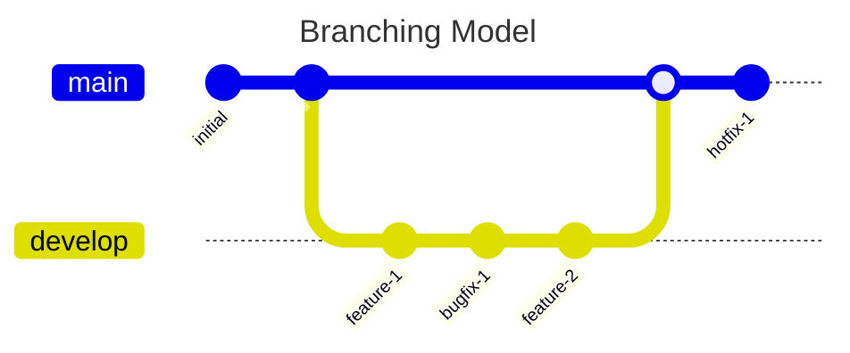

# fullstack-challenge-backend
This is the backend for fullstack techincal challenge

## Set up

## Environment variables

* **NODE_ENV** - *enum* - ['development', 'production', 'test'] Define the app environment. (default 'development')
* **PORT** - *int* - Port number exposed where backend runs. (default 3000)
* **PROVIDER_VEHICLES_URL** - *string* - URL consumed by Vehicles ingester to get "makes" and "vehicle types".(required)
* **LOGGING_LEVEL** - *string* - Minimum logging level used by pino-http. (default 'info')
* **DB_CONNECTION_URI** - *string* - Mongo connection uri. (default 'mongodb://localhost:27017/challenge-db')
* **REDIS_HOST** - *string* - Redis host for caching data. (default 'localhost')
* **REDIS_PORT** - *int* - The port where redis is exposed. (default 6379)

## Branching model justification

For this challenge I will work on development branch merging it when I finish the challenge simulating a production deliver, I also won't work in pre-prod environment (staging) or QA env, in order to save time we are not to have branches for those environment all testing will be performed locally in multiple platforms (Linux and Windows using VMs). Finally as in this challege there are only one person as developer it does not make sense to have feature branchs, however I will put all features and bugfixes in atomic commits. 

## Tasks (TODO):

* [*] Initialize the project using NestJS
* [*] Set-up the config module (add ZOD for validation)
* [*] Add and set-up nestJs scheduling to get vehicles every period of time
* [*] Set up the logging module
* [*] Design and make the first version the ingester
  * [*] Fetch vehicle type
  * [*] Fetch all makes
* [*] Start with the approach for error handling
* [*] Design and make the models for Mongo DB
* [ ] FIX-hardcoded vehicle type (I realized that the endpoint for vehicle type accepts /:makeId so need to fix it and make it performant)
  * [*] Add redis for caching
  * [*] Update Schema to embed vehicle types in make
  * [ ] Use redis to cache response data
  * [ ] Remove hardcoded 440 and use a Queue manager to handle vehicle types with limit rate
* [ ] Setup Unit test library
* [ ] Add test for Ingester
* [ ] Work on the service and resolver file
* [ ] Add/update Exception filters (if needed)

### Nice to have tasks:
* [ ] Add a retry capability to cron jobs when the fail.
* [ ] Update vehicle parser service to unify functions and avoid having repeated code.

## Bibliography (references)

* [NestJS - GraphQL quick start](https://docs.nestjs.com/graphql/quick-start)
  * ***Justification .-*** It is a long time I did not start a project in nest JS with graphQL, it is a good idea to follow the offical and newest way to do it.
* [NestJS - Configuration](https://docs.nestjs.com/application/configuration)
  * ***Justification .-*** Using the offcial docuemntation for config hadling is the best option in my mind.
* [NestJS - Task Scheduling](https://docs.nestjs.com/application/configuration)
* [NestJS - Life Cycle Events](https://docs.nestjs.com/fundamentals/lifecycle-events#asynchronous-initialization)
  * ***Justification .-*** Using the offcial docuemntation for scheduling task using cron, also used lifecycle events to get data when initializing the server.
* [NestJS - Http Client](https://docs.nestjs.com/application/http-client)
  * ***Justification .-*** I have experience using fetch and axios, now I wanted to experiment with http client from nestJS.
* [NestJS - Mongo DB](https://docs.nestjs.com/data/mongodb)
  * ***Justification .-*** For integrating mongo DB I used this documentation.
* [NestJS - Unions and Enums](https://docs.nestjs.com/graphql/unions-and-enums#code-first-1)
  * ***Justification .-*** I tried to follow this approach to merge vehicle types with makes but didn't work at all.
* [MDN - Global Object Errors](https://developer.mozilla.org/en-US/docs/Web/JavaScript/Reference/Global_Objects/Error)
  * ***Justification .-*** I needed this documentation to make custom Errors that are not inheritted from HttpException.
* [Pino Logger](https://getpino.io/#/docs/api?id=logger)
  * ***Justification .-*** I readed this API reference to instantiate and use Pino logger.
* [NestJS - Logger](https://docs.nestjs.com/application/logger#use-external-logger)
* [Production Logging in NestJS with Pino](https://medium.com/@rxman/production-logging-in-nestjs-with-pino-f21ee5844bd4)
* [Pino HTTP](https://github.com/pinojs/pino-http#api)
  * ***Justification .-*** Pino API documentation was not enough to set up completely, so I used this three(above) docuemtnation.
* [Fast XML Parser](https://github.com/NaturalIntelligence/fast-xml-parser)
  * ***Justification*** Library used for parsing XML to JS objects.
* [Zod API](https://zod.dev/api)
  * ***Justification .-*** It is no a bad idea keeping handy Zod API.
* [Mermaid.js](https://mermaid.js.org/intro/)
  * ***Justification .-*** It is my first time using mermaid for documentation diagrams, so I am following its syntax page.
* [Bug - Query root type must be provided](https://stackoverflow.com/questions/64105940/graphqlerror-query-root-type-must-be-provided)
  * ***Justification .-*** I got this error because I created the ingester first without having at least one @Query() function.
