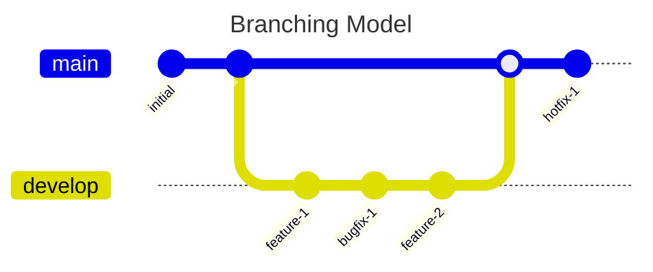

# fullstack-challenge-backend
This is the backend for fullstack techincal challenge

## Branching model justification

For this challenge I will work on development branch merging it when I finish the challenge simulating a production deliver, I also won't work in pre-prod environment (staging) or QA env, in order to save time we are not to have branches for those environment all testing will be performed locally in multiple platforms (Linux and Windows using VMs). Finally as in this challege there are only one person as developer it does not make sense to have feature branchs, however I will put all features and bugfixes in atomic commits. 

## Tasks (TODO):

* [*] Initialize the project using NestJS
* [ ] Set-up the config module
* [ ] Design and make the first version the providers
* [ ] Add the logging module
* [ ] Start with the technique for error handling
* [ ] Design and make the models for Mongo DB
* [ ] Setup Unit test tool and add test for Providers
* [ ] Work on the service and resolver file

## Bibliography

* [NestJS - GraphQL quick start](https://docs.nestjs.com/graphql/quick-start)
  * ***Justification .-*** It is a long time I did not start a project in nest JS with graphQL, it is a good idea to follow the offical and newest way to do it.
* [Mermaid.js](https://mermaid.js.org/intro/)
  * ***Justification .-*** It is my first time using mermaid for documentation diagrams, so I am following its syntax page.
