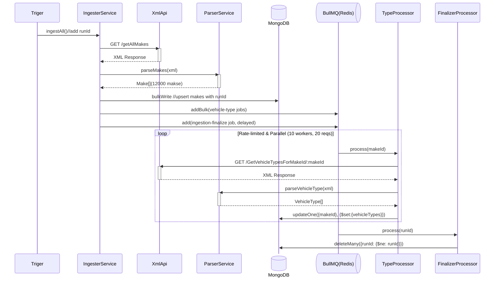

# Internal Ingestion Pipeline

This document describes how vehicle makes and their vehicle types are fetched from the external XML API, parsed, queued, and stored in MongoDB.

## Triggers

* **Application Startup** - Checks if the `makes` collection is empty. If it already has records, initial ingestion is skipped so the app boots fast. Otherwise, it triggers ingestion in the background.
* **Daily Cron Job** - Runs every day at midnight to keep makes and vehicle types updated.
* **In-memory Lock (isIngesting)** - Prevents overlapping runs if a previous ingestion is still queueing makes.

## Pipeline Steps

1. **Fetch & Parse Makes**
   * *VehicleFetchService* requests `/getallmakes?format=xml` from the provider API.
   * *VehicleParserService* uses `fast-xml-parser` to validate and transform the XML payload into an array of `{ makeId, makeName }` objects (~12,385 makes).

2. **Bulk Upsert Makes (bulkWrite)**
   * Generates a unique `runId` (UUID) for the current ingestion run.
   * Upserts all makes into MongoDB in a single `bulkWrite` operation, updating `makeName` and `runId` while keeping existing `vehicleTypes` intact (`$setOnInsert: { vehicleTypes: [] }`).

3. **Queue Vehicle Types (`vehicle-types` BullMQ queue)**
   * Since fetching vehicle types requires one HTTP call per `makeId` (`/GetVehicleTypesForMakeId/:makeId?format=xml`), doing ~12,385 requests sequentially or all at once would either take too long or overwhelm the external API.
   * All makes are added in bulk (`addBulk`) to the `vehicle-types` Redis queue.

4. **Worker Processing with Rate Limiting (`VehicleTypesProcessor`)**
   * Processes jobs in parallel controlled by environment variables:
     * **Concurrency**: `INGESTION_CONCURRENCY` (default `10`)
     * **Rate Limit**: `INGESTION_RATE_LIMIT_MAX` (default `20` requests) per `INGESTION_RATE_LIMIT_DURATION_MS` (default `1000` ms)
     * **Retries**: `INGESTION_MAX_ATTEMPTS` (default `3`) with exponential backoff (`1000ms`)
   * For each job, fetches the XML for `makeId`, parses the vehicle types, and updates the embedded `vehicleTypes` array inside the `Make` document.

5. **Cleanup Stale Makes (`IngestionFinalizeProcessor`)**
   * Runs on the `ingestion-finalize` queue and deletes any `Make` documents whose `runId` does not match the current `runId`, keeping the database clean without downtime.

## Sequence Diagram

